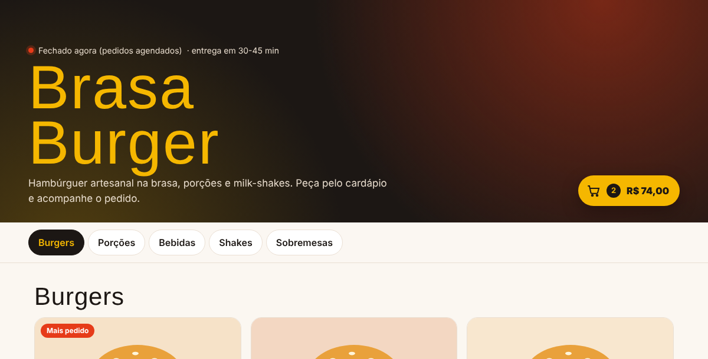

# Brasa Burger — Cardápio digital

Cardápio digital de hamburgueria com categorias de produtos, carrinho de compras, cálculo do total e simulação de pedido.

🔗 **[Ver o site no ar](https://iamviniciuslima05.github.io/PROJETO-MenuDigital/)**



## Funcionalidades

- Produtos organizados por **categorias**, com menu que acompanha a rolagem
- **Carrinho** com quantidade, subtotal e total salvo no navegador
- **Entrega ou retirada**, com taxa de entrega e frete grátis acima de R$ 80
- **Cupons de desconto** (teste `BEMVINDO10` ou `FRETEGRATIS`)
- Checkout com nome, WhatsApp, endereço e forma de pagamento (com troco)
- **Simulação do pedido**: número do pedido, linha do tempo do status e previsão de entrega
- Envio do pedido pronto pelo **WhatsApp**
- Status de loja aberta ou fechada pelo horário

## Tecnologias

HTML5 · CSS3 · JavaScript · SVG · localStorage

## Estrutura

```
index.html
css/style.css
js/script.js   → produtos, carrinho e pedido
```

## Como rodar

Não precisa instalar nada: baixe o projeto e abra o `index.html` no navegador, ou acesse a versão publicada acima.

> Para receber os pedidos no seu WhatsApp, troque o número na constante `WHATSAPP` no início do `js/script.js`.

---
Feito por **Vinicius Lima** · [Portfólio](https://viniciuslimadev.netlify.app) · [LinkedIn](https://www.linkedin.com/in/viniciuslima25/)
